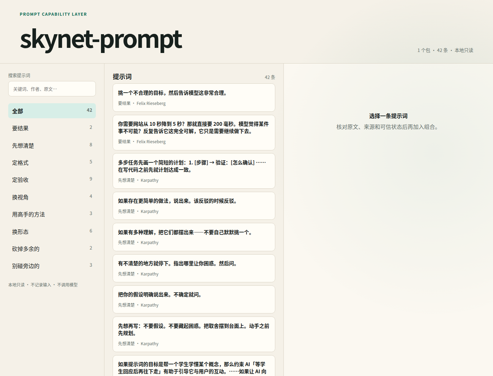

# skynet-prompt · 提示词补充

**平台支持：Linux（Ubuntu/Debian 系已验收）。Windows 与 macOS 暂不支持，未来提供。**

把「带来源、中文直译和可信状态」的提示词放到手边：统一输入 `；；` 打开提示词能力，
或在任何 agent 的 shell 里用一条 `psup` 命令取。ASCII 的 `;;` 仅作为兼容别名。

一共 42 条，9 个类目，4 个作者/来源（Karpathy 20 · Felix Rieseberg 9 ·
Ethan Mollick 3 · Fabric 10）。
每条都带原文、中文直译、作者、日期、链接、性质（本人原文 / 他人整理）。



## 为什么值得用

- **不是一堆复制粘贴的 prompt**：每条都保留原文、作者、日期、链接和可信状态。
- **同一个入口**：兼容宿主统一输入 `；；`，不用记不同 Agent 的私有语法。
- **本地优先**：42 条正文和索引离线可用，不依赖模型调用，不上传会话。
- **原样插入**：检索、预览、来源确认后再插入，不改写正文。
- **一条命令安装**：`skynet-prompt-bootstrap` 自动检测 Agent 和版本。
- **可验证**：`psup selftest` 固定内容哈希，`psup doctor` 检查本地安装状态。

## 两种形态

**统一触发器**：`；；`。支持输入框拦截的宿主会立即打开抽屉；其他宿主会把它解释为
“从 skynet-prompt 查询提示词”，通过指令或 MCP 降级。

**Hermes 抽屉**（人用）：输入 `；；`（兼容 `;;`），左列类目、右列该类条目 + 选中条目的完整预览。

```
 提示词补充 · 42 条 / 9 类   ↑↓ 选类目 · → 看条目 · Enter 补进输入框 · 直接打字可搜全库 · Esc 关闭
────────────────────────────────────────────────────────────────────
要结果             2 │ 挑一个不合理的目标，然后告诉模型…      Felix Rieseberg
先想清楚           6 │ ▸ 你需要网站从 10 秒降到 5 秒？那就…   Felix Rieseberg
▸ 定格式           4 │ 该类的下一条…
定验收             6 │
                       └────────────────────────────────────────────
                        原文  Pick unreasonable goals and tell the model …
                        中文  挑一个不合理的目标，然后告诉模型这非常合理。
                        作者  Felix Rieseberg · 2026-10-13
                        性质  本人原文
                        链接  https://felixrieseberg.com/…
```

键位：`↑↓` 选 · `→` 进右栏 · `←` 退回 · `Enter` 补进输入框 · `Esc` 关闭不插入 ·
直接打字＝全库搜索 · `⌫` 删字。补完输入框上方留一行「已补 1 层 · 类目 · 标题」，`⌥Z` 撤销。

**psup 命令**（agent 用，任何宿主）：不依赖任何 agent 的 UI，只读本地文件。

```sh
psup                    # fzf 两栏：左列表右预览，回车把中文吐到 stdout
psup 验收               # 非交互过滤，一行一条：id / 类目 / 中文 / 作者
psup show <id>          # 一条的全文（按终端显示宽度折行）
psup print <id>                    # 只要中文直译，可 $(psup print <id>)
psup print <id> --field en         # 只要英文原文
psup list --json        # 结构化输出
psup selftest           # 条数 + sha256，任何宿主拿它自证用的是哪份数据
psup reviews            # 校验来源、翻译和安全审核账本
psup safety             # 扫描提示注入、凭据外传和危险命令
psup sources            # 校验来源快照文件、SHA-256 和 manifest
psup candidates         # 列出 Club 候选；psup submit <json> 提交并去重
psup release            # 内容→审核→安全→v2 Pack 的完整发布流水线
psup registry <manifest> # 校验 Registry 与签名，可选出指定包
psup update             # 从 Registry 增量安装；同版本零下载
psup doctor             # 校验本地 Pack、签名与 Registry
psup cache              # 查看内容寻址缓存
psup rollback           # 回滚到上一安装版本
psup pin / unpin        # 固定或解除固定已安装版本
psup events             # 本地更新、回滚和固定审计事件
psup team               # 校验团队 Registry 与角色配置
psup approve            # 创建 reviewer/publisher 签名发布审批
psup suggest            # 可解释地建议候选，不改写正文
psup feedback           # 记录本地采纳、撤销和来源失效反馈
psup trust              # 查看第三方发布者公钥
psup print <id> --lang zh-CN # 读取指定语言译文
```

## 装

### 让 Agent 自己安装

把一句话交给具备终端、文件写入和网络能力的 Agent：

> 请读取 skynet-prompt 的 `AGENT_INSTALL.md`，先展示安装计划；我确认后执行安装，
> 最后报告 `selftest` 和 `doctor` 结果。不要读取凭据、发送提示词或执行远程脚本。

Agent 默认只能生成只读计划；用户确认后执行器才使用 `--apply`。安装契约和机器事实分别在
[`AGENT_INSTALL.md`](AGENT_INSTALL.md) 与 [`install-manifest.json`](install-manifest.json)。

### 一条命令自动检测安装

普通用户只需要：

```sh
./skynet-prompt-bootstrap
```

脚本会检测操作系统、Agent 和版本，显示兼容性与修改计划。确认后执行：

```sh
./skynet-prompt-bootstrap --apply
```

Agent 或自动化环境使用：

```sh
./skynet-prompt-bootstrap --json
```

不兼容的宿主会被跳过，最低通用能力仍是 `psup` CLI。

构建本地 release bundle：

```sh
python3 scripts/build_agent_release.py
```

输出位于 `dist/agent-release/v0.3.0/`，包含固定 tag 源码归档、manifest、
`AGENT_INSTALL.md`、`SHA256SUMS` 和 release 报告。该归档只包含 git 已跟踪文件。

正式签名需要同时提供私钥和 key id：

```sh
python3 scripts/build_agent_release.py \
  --private-key ~/.config/skynet-prompt/keys/skynet-club-dev.pem \
  --key-id skynet-club-dev-2026-11
```

### 手动安装

```sh
./install.sh                 # 自动检测 codex / pi / opencode / hermes / copilot / claude
./install.sh codex pi        # 只装指定宿主
./install.sh --list          # 看本机状态
./install.sh --uninstall codex
```

也可以 `psup install codex`（转发给同一个脚本）。

- **codex**：插件 + 42 条 `$psup-<id>` 技能 + `；；` 索引技能；默认不改
  `codex` 命令、不需要组合键。输入 `；；` 后回复类目或 id；显式 `$psup` 作为兼容入口。
- **pi**：`pi install` 本仓库，输入 `；；` 打开抽屉（兼容 `;;`）。
- **opencode**：输入框插件的兼容入口目前是 `/psup`（`/prompts` 同义）；需要 `/psup-<id>`
  直接命令时加 `--with-commands`。
- **hermes**：修改 `hermes_cli/cli_tui_mixin.py` 两处，改前自动备份到
  `~/.hermes/cache/skynet-prompt-backup/`。
- **copilot**：安装个人 Skill、MCP 和输入触发器 Extension；重新打开会话后输入 `；；`。
- **claude**：安装个人 Skill、UserPromptSubmit Hook 和用户级 MCP；重新打开会话后输入 `；；`。

所有宿主集成都可回滚；`--uninstall` 会恢复 codex 原软链、移除插件和复制过去的命令。
codex 升级后重跑一次 `./install.sh codex`。
Hermes 升级会覆盖 `hermes_cli/`，升级后重跑一次即可。

`psup` 本身零依赖（Python 3.8+ 标准库）；只有 fzf 交互模式需要 `fzf`。

原生即时抽屉、指令降级和命令行是三种不同能力。不要用“安装脚本成功”推断完整交互；
能力等级与触发方式以 `psup capabilities --json` 为准。

## 数据

```
Club / 飞书编辑工作区（候选、审核与导入，不是运行时真相源）
  └─ lark-cli base +record-list … --format ndjson --output raw.ndjson
       └─ scripts/freeze.py  →  data/prompts.json + data/meta.json（历史导入）
            └─ scripts/freeze_content.py  →  content/（逐条发布快照）
```

- `content/` 是发布与构建真相源；条目正文、元数据和整包 digest 从这里生成。
- `data/` 是旧客户端的兼容镜像，必须与 `content/` 逐字节一致，不允许作为独立编辑口。
- 编辑工作区可以持续变化，但只有审核后生成的不可变发布快照能进入 `content/`。
- 快照离线可用；文件缺失时抽屉不出空框，只在 stderr 报一行路径。

## 复核（在做的事）

`scripts/check_sources.py` 会拿每条原文去它标注的链接里找，逐片段核对：

```sh
python3 scripts/check_sources.py           # 用 reports/sources/ 里已抓的源文件
python3 scripts/check_sources.py --fetch   # 先抓再接（需要网络）
```

报告落 `reports/source-check.json`。当前状态：**42 条里 22 条逐字核对通过，12 条实为
他人整理的改写版本（已把链接改为整理来源、性质标「他人整理」），8 条未核到**。
发行前这批内容还要再修一轮——详见 `reports/source-check.json` 与 issue 清单。

## 扩展提示词包

内置 `data/` 仍是一个包；额外目录可以通过 `SKYNET_PROMPT_PACKS` 接入，同一份内容会同时
出现在 `psup`、Hermes 抽屉、MCP 和本地 HTTP 客户端里：

```sh
SKYNET_PROMPT_PACKS=/path/to/team-pack:/path/to/other-pack psup packs
```

外部目录包含 `pack.json` 与 `prompts.json`，格式和程序化 `PromptSource` 接口见
`docs/PROMPT_PACKS.md`；v2 严格契约见 `docs/PACK_V2.md`。条目 id 在全部包中必须唯一，
建议使用 `团队名-类目-序号`。

opencode 的 `/psup` 由 `adapters/opencode-plugin/` 提供：类目 → 条目 → 插入；`/prompts` 是同义入口。

来源证据和正式包导出：

```sh
psup audit
psupd                                # 只读本地 API，默认 127.0.0.1:8765
python3 scripts/export_official.py   # dist/official 只包含 verbatim + paraphrase
```

安全报告见 `docs/SAFETY.md`；自动扫描通过不等于人工审核通过。
审核账本见 `docs/REVIEWS.md`，内容变化会让旧审核自动失效。
来源快照契约见 `docs/SOURCE_SNAPSHOTS.md`。
候选状态与去重见 `docs/CANDIDATES.md`。
发布流水线见 `docs/RELEASE_PIPELINE.md`。
Registry 与签名见 `docs/REGISTRY.md`、`docs/SIGNING.md`。
客户端同步见 `docs/SYNC.md`。
团队私有源见 `docs/TEAM.md`。
发布审批见 `docs/APPROVALS.md`。
Advisor、反馈和评测见 `docs/ADVISOR.md`、`docs/FEEDBACK.md`、`docs/EVALUATIONS.md`。
第三方信任与多语言见 `docs/TRUST.md`、`docs/LANGUAGES.md`。
Club 频道发布流程与批次见 `docs/CLUB_PUBLISHING.md`。
剩余外部验收流程见 `docs/REMAINING_VALIDATION.md`。
本机 8 个 Agent 的实测矩阵见 `docs/AGENT_TEST_MATRIX.md`。

## 宿主产物

`content/` 是逐字节冻结的发布层（迁移期运行时仍读 `data/`，`psup verify` 证明兼容镜像一致）。
`adapters/` 下的产物由它生成，不要手改：

```sh
psup build                 # 生成 pi + codex + opencode
psup build --check         # 与 content/ 不一致就失败
```

- pi：`pi install git:github.com/<owner>/skynet-prompt`，输入 `；；` 打开抽屉
  （`/psup` 也可）；`/psup-<id>` 仍可直接插入单条
- codex：`codex plugin marketplace add <owner>/skynet-prompt`，
  再 `codex plugin add skynet-prompt@skynet-prompt`；输入 `；；` 开始浏览，
  显式 `$psup` 仍兼容。
- opencode：插件 `/psup` / `/prompts` 是当前输入框入口（默认不复制直接命令）；
  需要 `/psup-<id>` 时用 `--with-commands`
- copilot：`./install.sh copilot` 会执行 `copilot skill add` 和
  `copilot mcp add skynet-prompt`，并安装 `~/.copilot/extensions/skynet-prompt`；
  不读取登录 token。
- claude：`./install.sh claude` 会保留并备份现有 `settings.json`，只追加
  `skynet-prompt` Hook，并注册用户级 MCP。

正文是中文直译，逐字节来自 `content/items/<id>/zh.txt`；菜单描述里的
`本人原话 / 他人整理 / 未核实 / 节选` 是出处标记，不是正文。

## 边界

- Hermes、pi 抽屉在光标前是 `；；` / `;;` 时触发；代码块里的不介入
- 不支持输入框拦截的宿主把 `；；` 当作文本指令；没有 MCP 时退回 `psup`
- 不判断该补哪一条，不生成提示词，不评测输出质量
- Advisor 只给可解释候选，不自动选择、不自动插入，正文由用户确认后原样插入
- 原文版权归各作者，只做短句引用 + 署名 + 链接 + 日期（见 LICENSE）

## 测

```sh
python3 -m venv .venv
.venv/bin/pip install -r requirements-test.txt
python3 scripts/test.py        # 核心、CLI、补全器、抽屉、真会话
```
